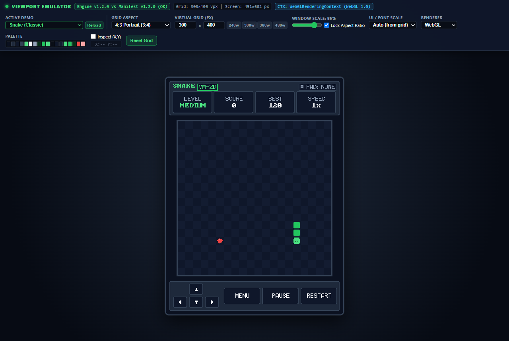
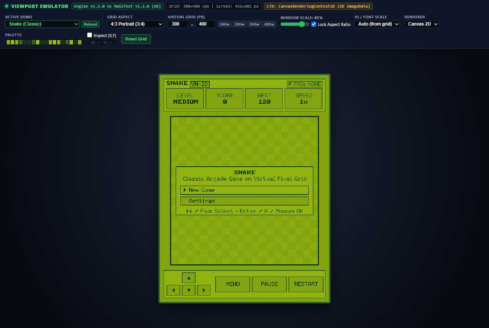
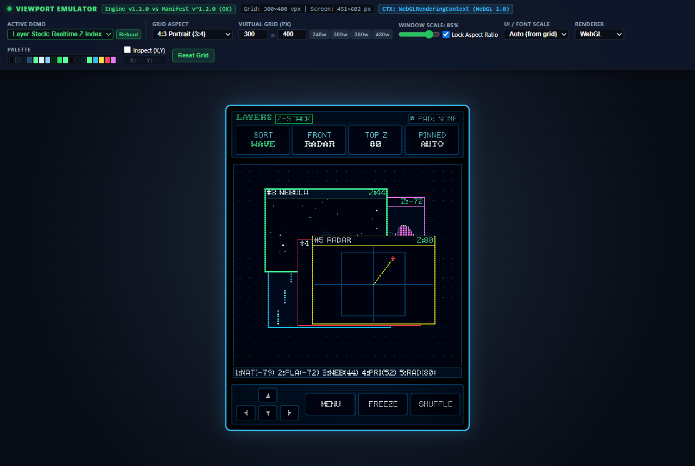
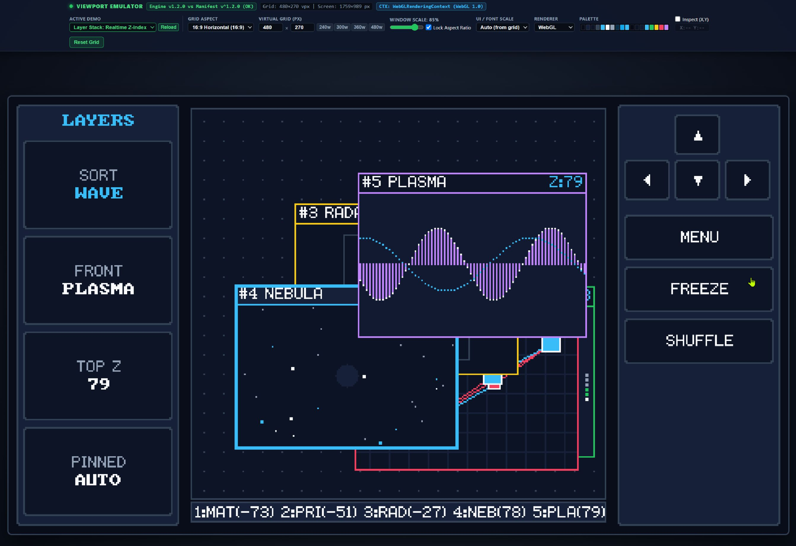

# f3engine — 2D Virtual Viewport Application & Game Engine

**f3engine** is a zero-dependency, modular 2D HTML5 engine built with TypeScript and Vite. It emulates a retro virtual pixel grid (`VirtualViewport`) with strict indexed color palettes (`ColorPalette`), multi-font 1-bit pixel-mask typography (`VirtualFont` & `VirtualFontCompiler`), a hierarchical application scene & control graph (`Node`, `CanvasNode`, `ContainerNode`, `ControlNode`, `AppRootNode`), normalized multi-modal input routing (`InputRouter`), versioned out-of-the-box UI control collections (`UIKit.ClassicV1`), hot-swappable physical renderer backends (`Canvas 2D` and `WebGL`), and a decoupled HTML debug bar (`degub_bar`).

---

## Screenshots

| **Snake (Classic) — WebGL & Debug Bar** | **Snake (Classic) — Old Nokia LCD Filter (Canvas 2D)** |
| :---: | :---: |
|  |  |
| **Layer Stack: Realtime Z-Index — CRT Filter (WebGL)** | **Layer Stack: Realtime Z-Index — 16:9 Horizontal Layout** |
|  |  |

---

## Repository Structure

```text
f3engine/
├── engine/                 # Core 2D engine structured into 4 DDD lifecycle layers + per-layer DI
│   ├── di/                 # EngineKernel, LayerServiceRegistry<'L1'..'L4'>, Shadow ServiceRegistrar (*.registrar.ts)
│   ├── l1_infrastructure/  # L1: Hardware, Platform, Palettes, Fonts, VirtualFramebuffer, RendererBackend, Viewport
│   ├── l2_runtime/         # L2: Scene Graph Nodes, NodeMetadataService, ChildOrderService, HitTestService, InputRouter
│   ├── l3_interaction/     # L3: LayerElevationService, VirtualUIDecorator, I18nManager, UIKit.ClassicV1
│   └── l4_domain/          # L4: DomainDepthPolicyService & domain boundary contracts
├── degub_bar/              # Standalone HTML Debug Bar consuming EngineDebugHooks
├── demos/
│   ├── games/              # Self-contained reference applications mirroring the 4-layer DDD structure
│   │   ├── snake/          # Demo 1: Classic 20×20 Arcade Snake (l1_infrastructure..l4_domain + *.registrar.ts)
│   │   └── layers/         # Demo 2: Layer Stack: Realtime Z-Index (5 animated backdrops + custom Z-order registrars)
│   └── html5_launcher/     # HTML5 wrapper app initializing the canvas, debug bar, and demo switcher
├── scripts/
│   └── compile-font.ts     # CLI compiler converting .otb/.ttf/.bdf fonts to 1-bit pixel masks with national locales
└── docs/
    ├── ARCHITECTURE.md     # Multi-bundle architecture, 4-layer DDD DI, Node & Control graph, InputRouter & font pipeline
    ├── DECISION_LOG.md     # Architectural Decision Records (ADR-001 through ADR-007)
    └── ROADMAP.md          # Non-linear idea map for engine sub-modules, visual effects, physics & DX
```

---

## Key Architectural Highlights

1. **Core Engine (`engine/`)**:
   - `ENGINE_VERSION` & `AppManifest` (`version.ts`) – Semantic engine versioning (`1.2.0`) and application manifest contract (`isEngineVersionCompatible`, `checkEngineVersion`). Every application built on `f3engine` supplies an `AppManifest` (`manifest.json`) declaring the engine version it targets.
   - **Hierarchical Application Node Graph (`engine/l2_runtime/nodes/`)**:
     - `Node<TProps, TState>` – Foundational tree node with typed `props` and `state`, lifecycle hooks (`HookPhase.BEFORE_UPDATE`, `AFTER_UPDATE`, `BEFORE_RENDER`, `AFTER_RENDER`), optional frame/tick processing, and cascading parent-over-child authority (`hide`, `show`, `enable`, `disable`, `freeze`, `unfreeze`, `resetState`, `unload`, `destroy`).
     - `CanvasNode` – Spatial 2D node on the virtual pixel grid (`VirtualRect`) with optional isolated offscreen surface caching (`useOwnSurface`).
     - `ContainerNode` & `ControlNode` – Layout orchestration, interactive pointer hit-testing (`hover` / `click`), focus states, and `modal` input barriers.
     - `AppRootNode` & `NodeTreeProcessor` – Connects the node tree to `EngineKernel`, `VirtualViewport`, `VirtualUIDecorator`, and `InputRouter`.
   - **Normalized Input Router (`engine/l2_runtime/input/`)**:
     - Aggregates Keyboard, `GamepadManager`, `VirtualViewport` pointer events, and synthetic on-screen controls (`DPadControl`) into normalized `ControlEvent` instances (`DIRECTION`, `ACTION`, `POINTER`, `GAMEPAD_STATUS`, `RAW_KEY`) dispatched top-down through the node tree with `event.consume()` and automatic modal barrier isolation.
   - **Namespaced Out-of-the-Box UI Kit (`UIKit.ClassicV1` in `engine/l3_interaction/ui/classic_v1/`)**:
     - Provides composable atomic and higher-level composite controls (`ResponsiveAppShellNode`, `HeaderBarControl`, `ScoreCardGroupControl`, `ControlDeckControl`, `DPadControl`, `ModalDialogNode` with cascading `openSubDialog`, `SettingsDialogNode`, `ReadyPromptDialogNode`, `MenuListControl`, `MenuChoiceItemControl`, `MenuActionItemControl`, `ButtonControl`, `BadgeControl`, `ScoreCardControl`, `PanelControl`).
   - `VirtualViewport`, `ColorPalette`, `VirtualFramebuffer`, `IRendererBackend` (`Canvas2DRendererBackend` / `WebGLRendererBackend`), `VirtualFont`, `VirtualFontCompiler`, `StorageStore<T>`, `I18nManager`, `VideoFilterManager`.

2. **Decoupled Debug Bar (`degub_bar/`)**:
   - Renders an HTML inspector bar that binds to the engine solely through `EngineDebugHooks`.
   - Displays live **Engine Version vs. App Manifest Engine Version** compatibility status (`Engine v1.2.0 vs Manifest v1.2.0 (OK)`), live runtime renderer context (`CTX: CanvasRenderingContext2D` / `WebGLRenderingContext`), and allows live inspection and overrides of grid aspect ratio, virtual resolution (`240w`, `300w`, `360w`, `480w`, or custom `W×H`), window scale percentage, UI/font scale multiplier, active renderer backend (`Canvas 2D` / `WebGL`), palette swatches, and virtual cursor `(X, Y)` coordinates.

3. **HTML5 Demo Launcher (`demos/html5_launcher/`)**:
   - Initializes the host stage, mounts the selected demo from `DEMO_CATALOG`, and connects `DebugToolbar`.
   - Supports live demo switching (`Snake (Classic)` ↔ `Layer Stack: Realtime Z-Index`) and full engine reset (`Reload`) directly from the top bar.

---

## Getting Started

1. **Install dependencies**:
   ```bash
   npm install
   ```

2. **Start the development server**:
   ```bash
   npm run dev
   ```

3. **Compile custom bitmap fonts (`.otb` / `.ttf` / `.bdf`) to 1-bit pixel masks**:
   ```bash
   npm run compile-font -- --input <path-to-font.otb> --output <out.ts> --id <font-id> --name "<Font Name>" --locales en,pl,de,cs,fi --scan-locales demos/games/snake/locales
   ```

4. **Build production bundles**:
   ```bash
   npm run build
   ```

5. **Preview production build**:
   ```bash
   npm run preview
   ```

---

## License

Released under the [MIT License](./LICENSE). Built-in retro PC bitmap font adaptations in `engine/l1_infrastructure/fonts/` derive from *The Ultimate Oldschool PC Font Pack v2.2* by VileR ([CC BY-SA 4.0](https://creativecommons.org/licenses/by-sa/4.0/)).
