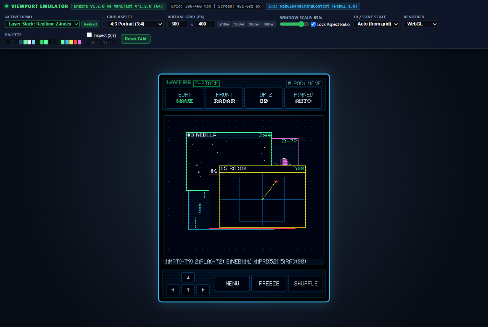
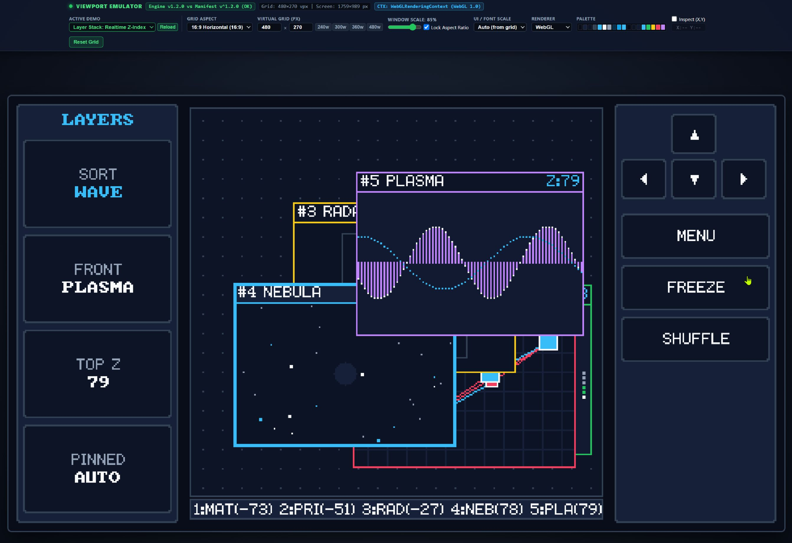

# Layer Stack: Realtime Z-Index (`demos/games/layers/`)

**Layer Stack: Realtime Z-Index** is a reference application built on **f3engine** demonstrating:
1. Simultaneous, independent rendering of **5 animated `AnimatedBackdropNode` (`ControlNode` / `CanvasNode`) instances** mounted as children of a dedicated `LayeredStageContainerNode extends ContainerNode`.
2. **Real-Time Z-Index & Group Sorting** injected by the application across the **4-Layer DDD Lifecycle & Shadow Service Registrar (`*.registrar.ts`)** architecture without modifying core engine defaults.

| **Portrait CRT Filter (WebGL)** | **16:9 Horizontal Responsive Layout** |
| :---: | :---: |
|  |  |

---

## 1. 4-Layer DDD Directory & Service Architecture

```text
demos/games/layers/
├── manifest.json
├── README.md
├── index.ts
├── locales/
│   ├── en.json
│   └── pl.json
├── l1_infrastructure/
│   ├── LayersSettingsRepository.ts
│   └── LayersSettingsRepository.registrar.ts
├── l2_runtime/
│   ├── RealtimeZIndexChildOrderService.ts
│   ├── RealtimeZIndexChildOrderService.registrar.ts
│   ├── AnimatedBackdropNode.ts
│   ├── LayeredStageContainerNode.ts
│   └── LayersAppRootNode.ts
├── l3_interaction/
│   ├── StageLayerInteractionService.ts
│   ├── StageLayerInteractionService.registrar.ts
│   ├── LayersI18nService.ts
│   └── LayersI18nService.registrar.ts
└── l4_domain/
    ├── BackdropUniverseService.ts
    └── BackdropUniverseService.registrar.ts
```

---

## 2. How Real-Time Z-Index Sorting Flows Across the 4 DDD Layers

1. **`L4_DOMAIN` (`BackdropUniverseService` + `BackdropUniverseService.registrar.ts`)**:
   - Hooked into `L4_DOMAIN_UPDATE` and `L4_DEPTH_EVALUATION`.
   - Simulates 5 drifting animated backdrop entities (`NEBULA` Starfield, `PLASMA` Sine Wave, `MATRIX` Digital Rain, `PRISMS` Bouncing Geometry, and `RADAR` Rotating Sweep) partitioned across two logical groups (`COSMIC` and `SYNTH`).
   - Evaluates each backdrop's universe depth score (`wave`, `random`, or `groups`) and publishes pure `DomainDepthFactDTO` records to `IL4ToL3BoundaryPort`.
2. **`L3_INTERACTION` (`StageLayerInteractionService` + `StageLayerInteractionService.registrar.ts`)**:
   - Hooked into `L3_LAYER_ELEVATION`.
   - Consumes `DomainDepthFactDTO` records, applies group priorities and user interaction overrides (highlighting / pinning a layer to the top via click, keyboard, or gamepad), and commits `LayerElevationDirectiveDTO` instructions to `IL3BoundaryPort`.
3. **`L2_RUNTIME` (`RealtimeZIndexChildOrderService` + `RealtimeZIndexChildOrderService.registrar.ts`)**:
   - Overrides `L2_TOKENS.ChildOrderService` in the `L2_RUNTIME` container.
   - Reads low-level node order metadata (`groupOrder`, `zIndex`, `insertionSequence`) from `INodeMetadataService` (updated automatically in `L2_ORDER_RESOLVE`) and provides sorted child arrays for both back-to-front rendering (`resolveRenderOrder`) and front-to-back hit-testing (`resolveInteractionOrder`).
4. **`L1_INFRASTRUCTURE` (`LayersSettingsRepository` + `LayersSettingsRepository.registrar.ts`)**:
   - Manages browser persistence (`StorageStore`) and semantic `ColorPalette` definitions for `None`, `CRT`, and `Old Nokia` video filters.
