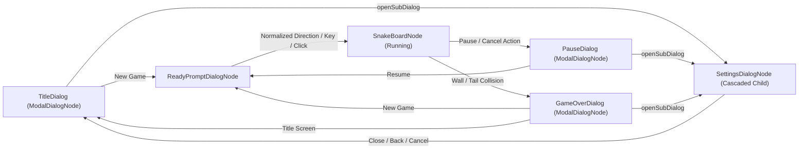

# Snake (Classic) — Reference Application & Game Design Document

**Snake (Classic)** (`demos/games/snake/`) is a complete, self-contained 2D arcade application built on **f3engine**. Its source directory is structured as a canonical blueprint for standalone applications built on the engine, bundling its own `manifest.json`, localization dictionaries (`locales/`), persistence settings, board `CanvasNode`, and root `AppRootNode`.

---

## 1. Application Directory Structure

```text
demos/games/snake/
├── README.md               # Application overview, architecture blueprint & Game Design Document (GDD)
├── manifest.json           # AppManifest declaring id ("snake"), app version, and target engineVersion ("1.2.0")
├── index.ts                # Application entrypoint exporting mountSnakeDemo(container) -> DemoSession
├── l1_infrastructure/      # L1: SnakeSettingsRepository + SnakeSettingsRepository.registrar.ts
├── l2_runtime/             # L2: SnakeAppRootNode & SnakeBoardNode
├── l3_interaction/         # L3: SnakeI18nService + SnakeI18nService.registrar.ts
├── l4_domain/              # L4: SnakeSimulationService + SnakeSimulationService.registrar.ts
└── locales/
    ├── en.json             # English UI & gameplay strings
    └── pl.json             # Polish UI & gameplay strings
```

---

## 2. High Concept & Engine Features Demonstrated

- **20×20 Virtual Grid Gameplay (`SnakeBoardNode extends CanvasNode`)**: Deterministic tick-driven movement, 2-step directional input buffering (`directionQueue`), progressive speed scaling, and `localStorage` high-score persistence (`StorageStore`).
- **Hierarchical Application Shell & Cascading Modals (`SnakeAppRootNode extends AppRootNode`)**: Composes `UIKit.ClassicV1` controls (`ResponsiveAppShellNode`, `HeaderBarControl`, `ControlDeckControl`, `ModalDialogNode`, `SettingsDialogNode`, `ReadyPromptDialogNode`).
- **Multi-Font 1-Bit Pixel-Mask Typography**: Uses two built-in engine default fonts simultaneously (`IBM PC BIOS 8×8` for headings/titles/score numbers and `HP 100LX 6×8` for HUD badges, buttons, and menu descriptions).
- **Real-Time Retro Display Emulation**: Supports `None`, `CRT Scanlines`, and `Old Nokia` (`pixelated: true` monochrome Nokia 3310 LCD simulation).

---

## 3. Core Application & Gameplay Flow



1. **Title Dialog**: Players can launch a new game or open **Settings** (`SettingsDialogNode` opened via `openSubDialog()` as a cascading child of the active modal) to switch language (`English` / `Polski`), difficulty, or video filter.
2. **Ready Prompt Dialog**: Freezes `SnakeBoardNode` until the player triggers any directional input, action key, gamepad button, or pointer click. If confirmed with a directional input (`UP`/`DOWN`/`LEFT`/`RIGHT`), `SnakeBoardNode` immediately queues that initial heading.
3. **Scoring & Speed Progression**:
   - Eating an apple grows the snake by **1 segment**, awards **+10 pts**, updates the persisted high score, and accelerates the movement tick interval according to the active difficulty preset.
4. **Game Over**: Colliding with the outer wall or the snake's own body freezes the board node, triggers gamepad dual-rumble feedback (if connected), and opens the **Game Over Dialog**.

---

## 4. Difficulty Presets (`SnakeSettings.ts`)

| Difficulty | Initial Interval (`baseIntervalMs`) | Minimum Interval (`minIntervalMs`) | Speedup Step (`stepEveryPoints`) | Interval Decrement (`speedDecrementMs`) | Profile |
| :--- | :--- | :--- | :--- | :--- | :--- |
| **Easy** | `165 ms` | `85 ms` | `40 pts` | `-6 ms` | Relaxed pace, gentle acceleration |
| **Medium** | `130 ms` | `60 ms` | `30 pts` | `-8 ms` | Balanced arcade challenge (default) |
| **Hard** | `92 ms` | `45 ms` | `20 pts` | `-7 ms` | Fast starting speed, rapid acceleration |

---

## 5. Video Filters & Palettes (`VideoFilterManager`)

### 5.1. `None` (`none`)
- **Style**: Crisp slate dark theme (`#0f172a` / `#1e293b`) with emerald snake segments (`#4ade80` / `#22c55e`) and rose target apples (`#f43f5e`).
- **Surface Rendering**: Subtle checkerboard cells, rounded snake segments with directional eyes, and highlighted target apples.

### 5.2. `CRT Scanlines` (`crt`)
- **Style**: Arcade cathode-ray tube monitor simulation.
- **Visual Effects**: Horizontal scanline overlay, corner vignette darkening, boosted contrast/saturation, and glowing frame border.

### 5.3. `Old Nokia` (`nokia`)
- **Style**: Monochrome LCD emulation inspired by the **Nokia 3310** (`#9bbc0f` / `#8bac0f` olive background with `#0f380f` / `#306230` dark LCD pixels).
- **Surface Rendering (`pixelated: true`)**: Sharp square LCD blocks with 1px inter-segment gaps, hollow diamond pixel pattern for apples, and a double outer border.

---

## 6. Normalized Controls (`InputRouter` + `UIKit.ClassicV1`)

- **Keyboard**: `Arrow Keys` / `WASD` to steer or navigate menus, `Enter` / `Space` (`CONFIRM`), `Escape` / `Backspace` (`CANCEL`), `P` (`PAUSE`), `R` (`RESTART`).
- **Gamepad**: D-Pad and analog sticks with deadzone, `A` (`CONFIRM`), `B` (`CANCEL`), `Start` (`PAUSE`), `X`/`Y` (`RESTART`), plus `dual-rumble` vibration on scoring and collision.
- **Mouse / Pointer**: Automatic `ControlNode` hit-testing across on-screen `DPadControl` buttons, HUD action buttons (`MENU`, `PAUSE`, `RESTART`), `MenuActionItemControl` rows, and `ChoicePillControl` options.
