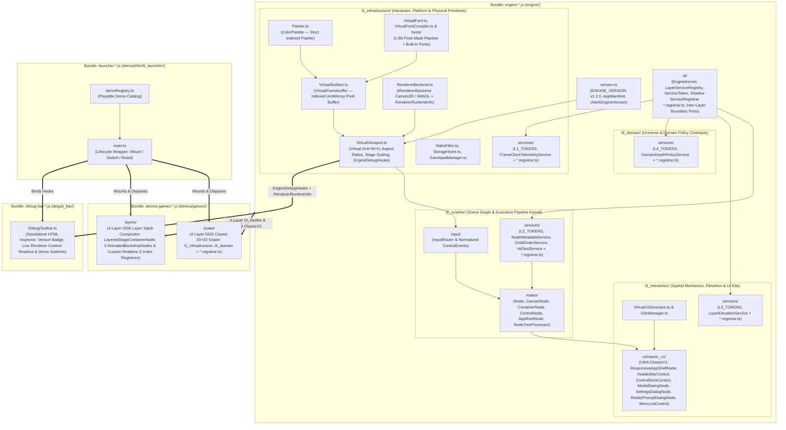

# Architecture — 4-Layer DDD Lifecycle, Per-Layer DI, Shadow Registrars, Node Graph & Demos

**f3engine** implements a **Virtual Viewport (2D Machine Emulator)** combined with a **4-Layer Domain-Driven Design (DDD) Lifecycle Architecture**, **Per-Layer Service Injection (`EngineKernel`) with Shadow Service Registrars (`*.registrar.ts`)**, and a **Hierarchical Application Node & Control Graph**. All application visuals, game boards, multi-layer animated backdrops, 1-bit pixel-mask fonts, HUD panels, modal dialogs, and virtual controls are organized as composable tree nodes (`Node`, `CanvasNode`, `ContainerNode`, `ControlNode`, `AppRootNode`) and rasterized onto an indexed virtual pixel grid (`VirtualFramebuffer`).

---

## 1. Module, Bundle & 4-Layer DDD Separation Diagram

---

## 2. Core Architectural Principles

### 2.1. Four-Layer DDD Lifecycle Architecture, Per-Layer DI & Shadow Service Registrars (`engine/di/`)

Both `engine/` and standalone applications under `demos/games/<app-id>/` share an identical **4-layer directory topology** reflecting the abstraction lifecycle of every frame:

| Layer Directory | Layer Identifier | Ubiquitous Language & Scope | Strict Isolation Rule |
| :--- | :--- | :--- | :--- |
| **`l1_infrastructure/`** | `'L1_INFRASTRUCTURE'` | Browser DOM, `CanvasRenderingContext2D`, `WebGLRenderingContext`, `RendererRuntimeInfo`, `Uint8Array` pixel buffers, `ColorPalette`, `VirtualFontSpec`, `Gamepad API`, `localStorage`, physical frame clock. | Completely blind to `Node` trees, UI controls, `zIndex`, and game rules. |
| **`l2_runtime/`** | `'L2_RUNTIME'` | `Node` scene graph, external `WeakMap` metadata (`INodeMetadataService`), child traversal ordering (`IChildOrderService`), spatial hit-testing (`IHitTestService`), normalized `ControlEvent` routing (`InputRouter`). | Completely blind to physical input hardware (`MouseEvent` vs. `Gamepad`) and game universe semantics. |
| **`l3_interaction/`** | `'L3_INTERACTION'` | Logical layer grouping and elevation (`ILayerElevationService`), focus/pinning, `VirtualUIDecorator`, `I18nManager`, and versioned `UIKit.ClassicV1` composite controls. | Consumes only normalized runtime signals and boundary DTOs; agnostic of game universe laws. |
| **`l4_domain/`** | `'L4_DOMAIN'` | Application & game universe rules (`IDomainDepthPolicyService`, grid movement, collision rules, autonomous backdrop simulations, world depth evaluation). | Operates purely on domain entities and domain math; zero knowledge of `Node`, `WeakMap`, or `IVirtualSurface`. |

#### Per-Layer Service Registries & Inter-Layer Boundary Ports
- `EngineKernel` (`engine/di/EngineKernel.ts`) maintains four isolated `LayerServiceRegistry<TLayer>` containers (`kernel.l1`, `kernel.l2`, `kernel.l3`, `kernel.l4`).
- Every service contract is identified by a layer-branded token `ServiceToken<TContract, TLayer>`. TypeScript prevents registering or injecting a token from one layer into another layer's registrar at compile time.
- Adjacent layers exchange data exclusively through immutable DTO boundary ports bound to each layer's local registry:
  - `L4_TOKENS.BoundaryPort` (`IL4ToL3BoundaryPort`) — publishes `DomainDepthFactDTO[]` from `L4` downwards to `L3`.
  - `L3_TOKENS.BoundaryPort` (`IL3BoundaryPort`) — reads `DomainDepthFactDTO[]` from `L4` and commits `LayerElevationDirectiveDTO[]` downwards to `L2`.
  - `L2_TOKENS.BoundaryPort` (`IL2FromL3BoundaryPort`) — drains `LayerElevationDirectiveDTO[]` into `INodeMetadataService` prior to child order resolution.

#### Pure Services + Shadow Service Registrars (`*.registrar.ts`) & Frame Phase Slots
- Inspired by Symfony service definitions (`ServiceDefinition` + tagged compiler passes), every service is a pure TypeScript class (POPO) receiving its layer-local dependencies via constructor injection.
- Alongside each service lives a companion **Shadow Registrar Class** (`*.registrar.ts`) extending `L1InfrastructureServiceRegistrar`, `L2RuntimeServiceRegistrar`, `L3InteractionServiceRegistrar`, or `L4DomainServiceRegistrar`:
  - `provides`: The layer-scoped `ServiceToken<TContract, TLayer>` fulfilled by the service.
  - `inject`: Tuple of layer-local `ServiceToken`s autowired into `createInstance(...)`.
  - `shouldRegister(ctx)`: Conditional registration guard with access only to `LayerRegistrationContext<TLayer>`. By default (`!ctx.hasProvider(this.provides)`), engine default registrars automatically yield whenever an application registers a custom override for the same token.
  - `getPipelineSlots()`: Declarative frame-phase slot bindings (`phase`, `priority`, and `execute(service, frameContext)` carrying `{ frameId, phaseId, dt, elapsedMs }`).
- **Deterministic Frame Lifecycle Schedule**:
  During every frame, `EngineKernel` executes compiled pipeline slots in strict order:
  1. **Update Pipeline (`executeUpdatePipeline(dt)`)**:
     `L1_INPUT_POLL` → `L2_SIGNAL_BROADCAST` → `L4_DOMAIN_UPDATE` → `L4_DEPTH_EVALUATION` → `L3_INTERACTION_SYNC` → `L3_LAYER_ELEVATION` → `L2_TREE_UPDATE` → `L2_ORDER_RESOLVE`
  2. **Render Pipeline (`executeRenderPipeline(dt)`)**:
     `L2_ORDER_RESOLVE` → `L1_SURFACE_PREPARE` → `L2_TREE_RENDER` → `L3_UI_SYNC` → `L1_SURFACE_PRESENT`

---

### 2.2. Blind Engine, Live Renderer Introspection & `EngineDebugHooks` Contract
- The `engine/` package has **zero knowledge** of `degub_bar/` or any external HTML toolbar elements.
- `VirtualViewport` (`engine/l1_infrastructure/VirtualViewport.ts`) sizes itself strictly relative to its parent stage container and exposes `getDebugHooks(): EngineDebugHooks`.
- `IRendererBackend` implementations (`Canvas2DRendererBackend` and `WebGLRendererBackend` in `engine/l1_infrastructure/RendererBackend.ts`) expose `getRuntimeInfo(): RendererRuntimeInfo`, querying the genuine active browser context instance (`this.ctx.constructor.name` → `"CanvasRenderingContext2D"` or `this.gl.constructor.name` → `"WebGLRenderingContext"`), graphics API version (`gl.getParameter(gl.VERSION)`), unmasked hardware driver (`WEBGL_debug_renderer_info`), fallback status, and presented frame counter.
- `DebugToolbar` (`degub_bar/DebugToolbar.ts`) subscribes to `EngineDebugHooks` and displays live badges for Engine vs. Manifest version compatibility (`state.versionCheck`), virtual vs. physical dimensions, and the active hardware rendering context (`CTX: CanvasRenderingContext2D (2D ImageData)` vs. `CTX: WebGLRenderingContext (WebGL 1.0)`).

---

### 2.3. Hierarchical Application Node Graph & Pluggable Runtime Services (`engine/l2_runtime/`)
- Every application running on **f3engine** is structured as a tree of `Node` instances starting at `AppRootNode` and processed by `NodeTreeProcessor`:
  - **`Node<TProps, TState>`**: Base node with typed `props` and `state`, optional per-frame `onUpdate(dt)` and interval-driven `onTick()` hooks, lifecycle phase hooks (`HookPhase.BEFORE_UPDATE`, `AFTER_UPDATE`, `BEFORE_RENDER`, `AFTER_RENDER`), and cascading parent authority over children (`show`, `hide`, `enable`, `disable`, `freeze`, `unfreeze`, `resetState`, `unload`, `destroy`).
  - **`CanvasNode<TProps, TState>`**: Spatial 2D node on the virtual pixel grid (`VirtualRect`) with surface clipping (`surface.setClipRect`) and optional isolated offscreen buffer caching (`useOwnSurface` backed by an internal `VirtualFramebuffer`).
  - **`ContainerNode<TProps, TState>`**: Layout container (`onLayout(bounds)`) providing batch child state operations (`freezeChildren`, `unfreezeChildren`, `hideChildren`, `activateOnlyChild`).
  - **`ControlNode<TProps, TState>`**: Interactive UI control supporting pointer hit-testing (`hover` / `click`), focus states, cursor styling, and `modal = true` input barriers.
  - **`AppRootNode<TProps, TState>`**: Root container initializing `EngineKernel` (evaluating application `config.registrars` first and `DEFAULT_ENGINE_REGISTRARS` second) and connecting `VirtualViewport`, `VirtualUIDecorator`, `InputRouter`, and `NodeTreeProcessor`.
- `NodeTreeProcessor` delegates child ordering and pointer picking to injected `L2_RUNTIME` services:
  - `INodeMetadataService` (`L2_TOKENS.NodeMetadataService`) stores external ordering and grouping attributes (`layerGroup`, `groupOrder`, `zIndex`, `insertionSequence`) in a `WeakMap<Node, NodeRuntimeMetadata>` without polluting `Node`.
  - `IChildOrderService` (`L2_TOKENS.ChildOrderService`) supplies `resolveRenderOrder(parent)` (back-to-front) and `resolveInteractionOrder(parent)` (front-to-back). By default, `DefaultInsertionChildOrderService` preserves child insertion order; applications can override `L2_TOKENS.ChildOrderService` via a custom `L2RuntimeServiceRegistrar` (such as `RealtimeZIndexChildOrderServiceRegistrar` in `demos/games/layers/`) to sort children dynamically in real time.
  - `IHitTestService` (`L2_TOKENS.HitTestService`) traverses children in `childOrderService.resolveInteractionOrder(node)`, guaranteeing that pointer hit-testing and keyboard/gamepad routing always match the live visual Z-order.

---

### 2.4. Normalized Input Abstraction (`engine/l2_runtime/input/`)
- `InputRouter` aggregates Keyboard input, `GamepadManager` state, `VirtualViewport` pointer coordinates (`MOVE`, `CLICK`, `LEAVE` in virtual pixels `vx, vy`), and synthetic on-screen controls (`DPadControl`) into normalized `ControlEvent` instances (`DirectionControlEvent`, `ActionControlEvent`, `PointerControlEvent`, `GamepadStatusControlEvent`, `RawKeyControlEvent`).
- Events propagate top-down in front-to-back interaction order (`resolveInteractionOrder`). Any node can call `event.consume()` to stop propagation, and any visible `ControlNode` with `modal = true` acts as an automatic barrier preventing input from leaking to background nodes.

---

### 2.5. Versioned UI Control Kits (`UIKit.ClassicV1` in `engine/l3_interaction/ui/classic_v1/`)
- Built-in controls are encapsulated inside versioned namespaces (`UIKit.ClassicV1`):
  - `ResponsiveAppShellNode` – Orchestrates `HeaderBarControl`, the main application `CanvasNode` / `ContainerNode` slot, `ControlDeckControl`, and the `modalLayer` container across Portrait (`top-bar`) and Horizontal (`left-sidebar`) aspect ratios.
  - `HeaderBarControl` & `ScoreCardGroupControl` – Manages brand badges, automatic gamepad connection status updates, and metric `ScoreCardControl` children.
  - `ControlDeckControl` & `DPadControl` – Manages the 4 directional `ButtonControl` children (`▲`, `◀`, `▼`, `▶`) and action buttons (`Menu`, `Pause/Freeze`, `Restart/Shuffle`).
  - `ModalDialogNode`, `MenuListControl`, `SettingsDialogNode`, & `ReadyPromptDialogNode` – Manages `MenuActionItemControl` and `MenuChoiceItemControl` (with child `ChoicePillControl`s), automatic `selectedIndex` navigation, and cascading child sub-dialogs (`openSubDialog` / `closeSubDialog`).

---

### 2.6. Self-Contained 4-Layer Application Blueprint (`demos/games/<app-id>/`)
Every demo directory under `demos/games/` mirrors a standalone application project built on **f3engine** using the canonical 4-layer DDD structure:
- **`demos/games/snake/` (Snake Classic)**:
  - `l1_infrastructure/` – `SnakeSettingsRepository` + `SnakeSettingsRepository.registrar.ts` (`StorageStore` persistence and filter palettes).
  - `l2_runtime/` – `SnakeAppRootNode` and `SnakeBoardNode`.
  - `l3_interaction/` – `SnakeI18nService` + `SnakeI18nService.registrar.ts`.
  - `l4_domain/` – `SnakeSimulationService` + `SnakeSimulationService.registrar.ts` (pure 20×20 grid movement, collision detection, food spawning, and speed progression rules).
- **`demos/games/layers/` (Layer Stack: Realtime Z-Index)**:
  - `l1_infrastructure/` – `LayersSettingsRepository` + `LayersSettingsRepository.registrar.ts`.
  - `l2_runtime/` – `RealtimeZIndexChildOrderService` + `RealtimeZIndexChildOrderService.registrar.ts` (overriding `L2_TOKENS.ChildOrderService`), `LayeredStageContainerNode extends ContainerNode`, `AnimatedBackdropNode extends ControlNode`, and `LayersAppRootNode`.
  - `l3_interaction/` – `StageLayerInteractionService` + `StageLayerInteractionService.registrar.ts` (overriding `L3_TOKENS.LayerElevationService` in `L3_LAYER_ELEVATION` to handle group priorities and user-pinned layers) and `LayersI18nService`.
  - `l4_domain/` – `BackdropUniverseService` + `BackdropUniverseService.registrar.ts` (overriding `L4_TOKENS.DomainDepthPolicyService` in `L4_DOMAIN_UPDATE` and `L4_DEPTH_EVALUATION` to simulate 5 drifting animated backdrops across `COSMIC` and `SYNTH` groups and compute real-time harmonic wave, random shuffle, or group cascade depth scores).
