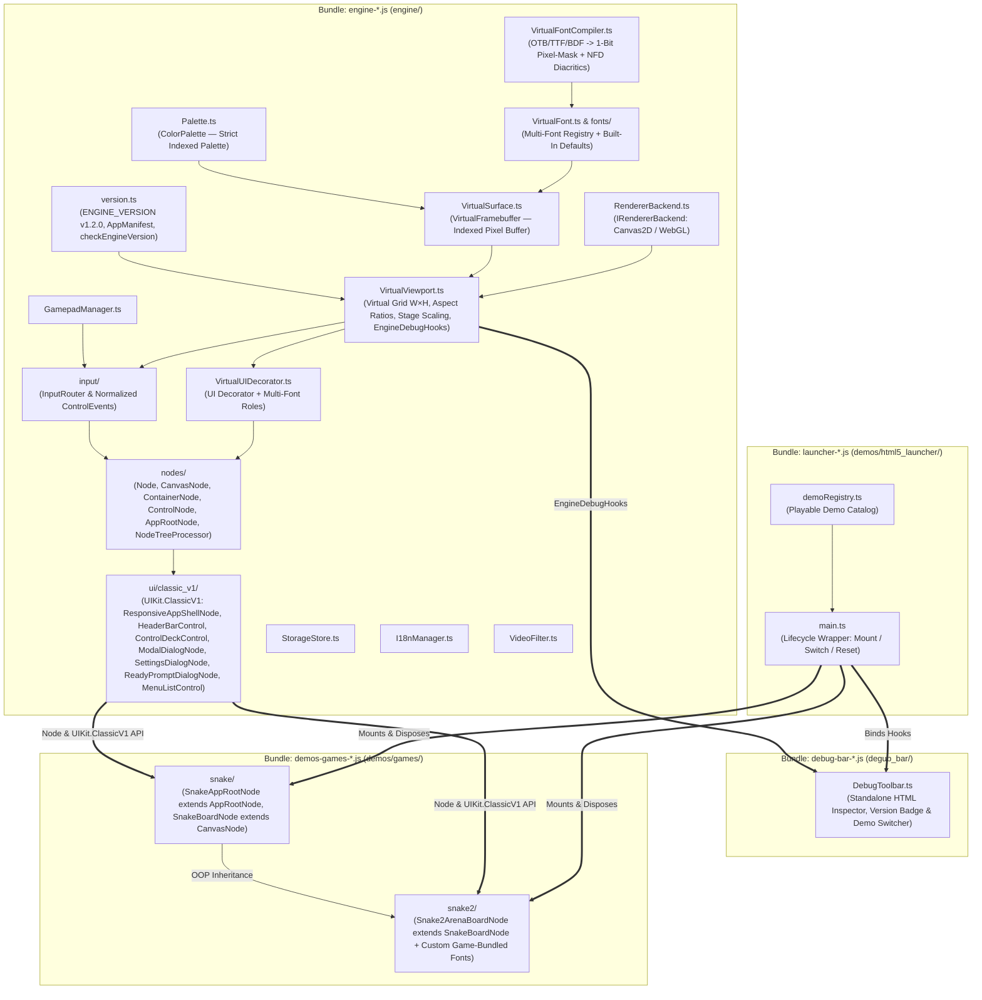

# Architecture — Engine, Node Graph, UI Kits, Debug Bar & Demos

**f3engine** implements a **Virtual Viewport (2D Machine Emulator)** combined with a **Hierarchical Application Node & Control Graph**: all application visuals, game boards, 1-bit pixel-mask fonts, HUD panels, modal dialogs, and virtual controls are organized as composable tree nodes (`Node`, `CanvasNode`, `ContainerNode`, `ControlNode`, `AppRootNode`) and rasterized onto an indexed virtual pixel grid (`VirtualFramebuffer`).

---

## 1. Module & Bundle Separation Diagram

---

## 2. Core Architectural Principles

### 2.1. Blind Engine & `EngineDebugHooks` Contract
- The `engine/` package has **zero knowledge** of `degub_bar/` or any external HTML toolbar elements.
- `VirtualViewport` sizes itself strictly relative to its parent stage container (`hostContainer.parentElement`) and exposes `getDebugHooks(): EngineDebugHooks`.
- `EngineDebugHooks` provides a clean programmatic API:
  - `getState()` & `subscribe(listener)` – Reactive snapshots including engine version (`engineVersion`), application manifest (`appManifest`), version compatibility (`versionCheck`), virtual/physical dimensions, aspect ratio, scale factors, active backend, cursor coordinates, and palette entries.
  - `getEngineVersion()` & `getAppManifest()`
  - `setVirtualGrid(width, aspectRatio, customHeight)`
  - `setPhysicalScaling(windowScalePercent, lockAspectRatio)`
  - `setUIScaleOverride(scale)`
  - `setRendererBackend('canvas2d' | 'webgl')`
  - `setCursorInspectorEnabled(enabled)`
  - `resetToDefaults()` & `updatePhysicalSize()`

### 2.2. Hierarchical Application Node Graph (`engine/nodes/`)
- Every application running on **f3engine** is structured as a tree of `Node` instances starting at `AppRootNode` and processed by `NodeTreeProcessor`:
  - **`Node<TProps, TState>`**: Base node with typed `props` and `state`, optional per-frame `onUpdate(dt)` and interval-driven `onTick()` hooks, lifecycle phase hooks (`HookPhase.BEFORE_UPDATE`, `AFTER_UPDATE`, `BEFORE_RENDER`, `AFTER_RENDER`), and cascading parent authority over children (`show`, `hide`, `enable`, `disable`, `freeze`, `unfreeze`, `resetState`, `unload`, `destroy`).
  - **`CanvasNode<TProps, TState>`**: Spatial 2D node on the virtual pixel grid (`VirtualRect`) with optional isolated offscreen buffer caching (`useOwnSurface` backed by an internal `VirtualFramebuffer`).
  - **`ContainerNode<TProps, TState>`**: Layout container (`onLayout(bounds)`) providing batch child state operations (`freezeChildren`, `hideChildren`, `activateOnlyChild`).
  - **`ControlNode<TProps, TState>`**: Interactive UI control supporting pointer hit-testing (`hover` / `click`), focus states, cursor styling, and `modal = true` input barriers.
  - **`AppRootNode<TProps, TState>`**: Root container connecting `VirtualViewport`, `VirtualUIDecorator`, `InputRouter`, and `NodeTreeProcessor`.

### 2.3. Normalized Input Abstraction (`engine/input/`)
- Applications and UI controls do not attach low-level DOM keyboard or gamepad listeners. Instead, `InputRouter` aggregates:
  1. Keyboard input (`Arrow*`, `WASD`, `Enter`, `Space`, `Escape`, `Backspace`, `KeyP`, `KeyR`, `Tab`)
  2. `GamepadManager` input (D-Pad, analog sticks with deadzone, action buttons, and connection status)
  3. `VirtualViewport` pointer coordinates (`MOVE`, `CLICK`, `LEAVE` in virtual pixels `vx, vy`)
  4. Synthetic virtual control triggers (such as clicking the on-screen `DPadControl`)
- `InputRouter` emits normalized `ControlEvent` instances (`DirectionControlEvent`, `ActionControlEvent`, `PointerControlEvent`, `GamepadStatusControlEvent`, `RawKeyControlEvent`) into `NodeTreeProcessor`.
- `NodeTreeProcessor` routes events top-down in reverse child order (top-most rendered layer first). Any node can call `event.consume()` to stop propagation, and any visible `ControlNode` with `modal = true` acts as an automatic barrier preventing input from leaking to background nodes.

### 2.4. Versioned UI Control Kits (`UIKit.ClassicV1` in `engine/ui/classic_v1/`)
- Built-in controls are encapsulated inside versioned namespaces (`UIKit.ClassicV1`) so future control collections can be introduced alongside existing ones while preserving backward compatibility.
- Higher-level composite controls manage the states, highlighting, focus, and layout of their child controls automatically:
  - `ResponsiveAppShellNode` – Orchestrates `HeaderBarControl`, the main application `CanvasNode` slot, `ControlDeckControl`, and the `modalLayer` container across Portrait and Horizontal aspect ratios.
  - `HeaderBarControl` & `ScoreCardGroupControl` – Manages brand badges, automatic gamepad connection status updates, and metric `ScoreCardControl` children.
  - `ControlDeckControl` & `DPadControl` – Manages the 4 directional `ButtonControl` children (`▲`, `◀`, `▼`, `▶`) and action buttons (`Menu`, `Pause/Resume`, `Restart`).
  - `ModalDialogNode` & `MenuListControl` – Manages `MenuActionItemControl` and `MenuChoiceItemControl` (with child `ChoicePillControl`s), automatic `selectedIndex` navigation, and **cascading child sub-dialogs (`openSubDialog` / `closeSubDialog`)**.
  - `SettingsDialogNode` & `ReadyPromptDialogNode` – Ready-to-use modal dialogs for application settings and pre-start readiness prompts.

### 2.5. Engine Versioning & Application Manifests (`engine/version.ts`)
- The engine exports `ENGINE_VERSION` (`"1.2.0"`) along with `AppManifest` and `checkEngineVersion(...)`.
- Every application built on **f3engine** includes a `manifest.json` conforming to `AppManifest` (`id`, `name`, `version`, `engineVersion`).
- `DebugToolbar` (`degub_bar/`) reads `state.versionCheck` from `EngineDebugHooks` and displays a live comparison badge (`Engine v1.2.0 vs Manifest v1.2.0 (OK)`).

### 2.6. Multi-Font Pixel-Mask Pipeline & Strict Indexed Color Palette
- Fonts are compiled ahead-of-time into `VirtualFontSpec` 1-bit pixel masks (`VirtualFontCompiler` + `scripts/compile-font.ts`) with national character presets (`en`, `pl`, `de`, `cs`, `fi`, `latin-ext`) and Unicode `NFD` diacritic synthesis.
- `VirtualFramebuffer` stores the virtual grid as a `Uint8Array` of palette indices (`virtualWidth * virtualHeight`), presented by either `Canvas2DRendererBackend` or `WebGLRendererBackend`.

### 2.7. Self-Contained Application Directory Blueprint (`demos/games/<app-id>/`)
- Every demo directory under `demos/games/` is intentionally structured to mirror a **real standalone application project** built on top of **f3engine**.
- Engine documentation in root `docs/` stays strictly dedicated to engine architecture, ADRs, and engine sub-module ideas, whereas each application owns its complete domain package inside its own directory:
  - `manifest.json` – `AppManifest` declaring application `id`, `name`, `version`, and target `engineVersion`.
  - `README.md` – Co-located application architecture overview and Game Design Document (GDD).
  - `index.ts` – Application bootstrap mounting `VirtualViewport`, `VirtualUIDecorator`, and the root `AppRootNode` subclass, returning a clean `DemoSession` (`dispose()`).
  - `locales/*.json` & `i18n.ts` – Application-specific translation dictionaries passed to `I18nManager`.
  - `fonts/` *(optional)* – Application-bundled `VirtualFontSpec` bitmap fonts compiled via `npm run compile-font`.
  - `*AppRootNode.ts` / `*BoardNode.ts` – Domain classes extending `AppRootNode` and `CanvasNode` (or extending another application's board node via OOP inheritance, as in `Snake2ArenaBoardNode extends SnakeBoardNode`).
