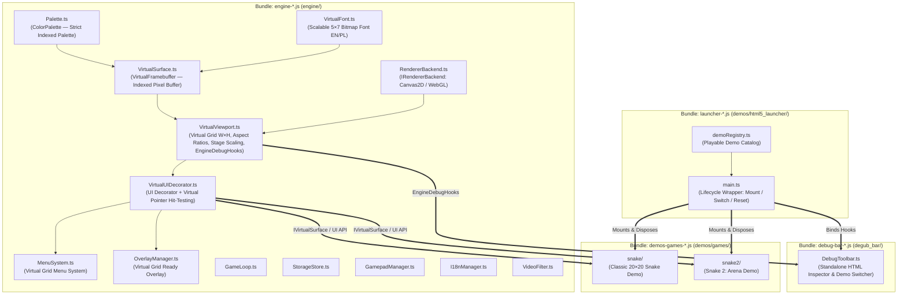

# Architecture — Engine, Debug Bar, Demos & HTML5 Launcher

**f3engine** implements a **Virtual Viewport (2D Machine Emulator)** architecture: all game graphics, boards, bitmap fonts, HUD panels, menus, and virtual controls are rasterized onto a virtual pixel grid with a declared resolution, aspect ratio, and indexed color palette.

---

## 1. Module & Bundle Separation Diagram

---

## 2. Core Architectural Principles

### 2.1. Blind Engine & `EngineDebugHooks` Contract
- The `engine/` package has **zero knowledge** of `degub_bar/` or any external HTML toolbar elements.
- `VirtualViewport` sizes itself strictly relative to its parent stage container (`hostContainer.parentElement`) and exposes `getDebugHooks(): EngineDebugHooks`.
- `EngineDebugHooks` provides a clean programmatic API:
  - `getState()` & `subscribe(listener)` – Reactive snapshots including virtual/physical dimensions, aspect ratio, scale factors, active backend, cursor coordinates, and palette entries.
  - `setVirtualGrid(width, aspectRatio, customHeight)`
  - `setPhysicalScaling(windowScalePercent, lockAspectRatio)`
  - `setUIScaleOverride(scale)`
  - `setRendererBackend('canvas2d' | 'webgl')`
  - `setCursorInspectorEnabled(enabled)`
  - `resetToDefaults()` & `updatePhysicalSize()`

### 2.2. Virtual Pixel Grid & Aspect Ratio Presets (`VirtualViewport`)
- The virtual pixel grid (`virtualWidth × virtualHeight`) is completely independent of the physical display resolution.
- Built-in aspect ratio presets (`ViewportAspectRatio`):
  - `'4:3-portrait'` (`3:4`, default for Snake demos: `300×400` virtual pixels)
  - `'4:3-horizontal'` (`4:3`)
  - `'16:9-portrait'` (`9:16`)
  - `'16:9-horizontal'` (`16:9`)
  - `'custom'` (arbitrary `W × H` dimensions)

### 2.3. Strict Indexed Color Palette (`ColorPalette` + `VirtualFramebuffer`)
- Each demo declares its own `ColorPalette` definitions per video filter.
- `VirtualFramebuffer` stores the virtual grid as a `Uint8Array` of palette indices (`virtualWidth * virtualHeight`).
- Every virtual pixel (game entities, bitmap text, and UI panels) resolves strictly to an index in the active palette.

### 2.4. Swappable Renderer Backends (`IRendererBackend`)
- Game logic and UI decorators draw exclusively onto the abstract `IVirtualSurface` interface.
- Physical presentation is handled by a hot-swappable `IRendererBackend`:
  - `Canvas2DRendererBackend` – Converts the indexed buffer via a 32-bit ABGR LUT directly into `ImageData`.
  - `WebGLRendererBackend` – Uploads the indexed buffer as a `LUMINANCE` texture and the palette as a `256×1 RGBA` LUT texture to a WebGL fragment shader.

### 2.5. HTML5 Demo Launcher & Lifecycle Management (`demos/html5_launcher/`)
- Every demo in `demos/games/` implements a mount function returning a `DemoSession` with a `dispose()` method that stops game loops, unbinds keyboard/gamepad listeners, and disposes the `VirtualViewport`.
- When the user selects another demo or clicks `Reload` in the Debug Bar, the launcher disposes the active session, mounts the new demo onto `#app`, and rebinds `DebugToolbar` via `debugToolbar.bindEngine(...)`.
