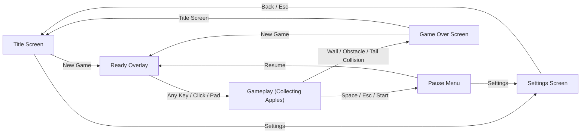

# Game Design Document (GDD) — Snake Demos

## 1. High Concept
Two classic arcade **Snake** demos built on **f3engine**, combining responsive grid gameplay with retro display emulation (**CRT Scanlines** and **Old Nokia 3310 LCD**) and multi-font pixel-mask typography:
- **Demo 1 (`demos/games/snake`)**: Classic 20×20 arcade Snake using two built-in **Engine Default Fonts** simultaneously (`IBM PC BIOS 8×8` for titles/headings/score values and `HP 100LX 6×8` for HUD controls, badges, and menus).
- **Demo 2 (`demos/games/snake2`)**: **Snake 2: Arena** featuring four corner L-shaped obstacle pillars, a gold/violet cyberpunk palette, two simultaneous apples on the board, and **Custom Game-Bundled Third-Party Fonts** (`demos/games/snake2/fonts/`: `Amstrad PC 8×8` for headings/scores and `ATI SmallWonder 6×8` with NFD-synthesized national diacritics for HUD and body text).

---

## 2. Core Gameplay Loop

1. Players start on the **Title Screen**, where they can launch a new game or open **Settings** to configure language (`English` / `Polski`), difficulty, and video filter.
2. Before movement begins, the **Ready Overlay** pauses the board until the player presses any key, gamepad button, or clicks the viewport.
3. Eating an apple:
   - Grows the snake by **1 segment**,
   - Awards points (**+10 pts** in Classic Snake, **+15 pts** in Snake 2: Arena) and updates the persisted high score in `localStorage`,
   - Increases movement speed according to the active difficulty preset.
4. Colliding with the board border, an arena pillar (in Snake 2), or the snake's own tail triggers **Game Over**.

---

## 3. Difficulty Presets

Difficulty is persisted in `localStorage`. Parameters defined in `SnakeSettings.ts`:

| Difficulty | Initial Interval (`baseIntervalMs`) | Minimum Interval (`minIntervalMs`) | Speedup Step (`stepEveryPoints`) | Interval Decrement (`speedDecrementMs`) | Profile |
|------------|-------------------------------------|------------------------------------|----------------------------------|-----------------------------------------|---------|
| **Easy**   | `165 ms` | `85 ms` | `40 pts` | `-6 ms` | Relaxed pace, gentle acceleration |
| **Medium** | `130 ms` | `60 ms` | `30 pts` | `-8 ms` | Balanced arcade challenge (default) |
| **Hard**   | `92 ms`  | `45 ms` | `20 pts` | `-7 ms` | Fast starting speed, rapid acceleration |

---

## 4. Video Filters & Palettes (`VideoFilterManager`)

Each demo supports three real-time visual profiles:

### 4.1. `None` (`none`)
- **Style**: Crisp dark theme (`#0f172a` / `#1e293b` in Classic Snake; deep violet/amber `#090614` / `#1b1336` in Snake 2: Arena).
- **Virtual Surface Rendering**: Subtle checkerboard cells, rounded snake segments with directional eyes, and highlighted target apples.

### 4.2. `CRT Scanlines` (`crt`)
- **Style**: Arcade cathode-ray tube monitor simulation.
- **Visual Effects**: Horizontal scanline overlay (`background-size: 100% 4px`), corner vignette darkening, boosted contrast/saturation, and glowing frame border.

### 4.3. `Old Nokia` (`nokia`)
- **Style**: Faithful monochrome LCD emulation inspired by the **Nokia 3310**.
- **Color Palette**: Olive LCD background (`#9bbc0f` / `#8bac0f`) and dark green pixels (`#0f380f` / `#306230`).
- **Virtual Surface Rendering (`pixelated: true`)**:
  - Sharp square LCD blocks with 1px inter-segment gaps instead of rounded corners.
  - Classic hollow diamond pixel pattern for apples.
  - Double outer border with a fine CSS LCD pixel grid overlay.

---

## 5. Controls & UX

- **Input Queue (`directionQueue`)**: Buffers up to 2 directional changes per logic tick to prevent accidental self-collision during rapid key sequences.
- **Multi-Modal Navigation**:
  - **Keyboard**: `Arrow Keys` / `WASD` to steer or navigate menus, `Enter` / `Space` to confirm, `Escape` to pause or go back, `R` for quick restart.
  - **Gamepad**: D-Pad and analog sticks with deadzone, `A` to confirm, `B` to go back, `Start` to pause, `X`/`Y` to restart, plus `dual-rumble` vibration on scoring and game over.
  - **Mouse / Touch**: On-screen virtual D-Pad and action buttons (`MENU`, `PAUSE`, `RESTART`), plus hover and click support across all menu rows and choice pills.
